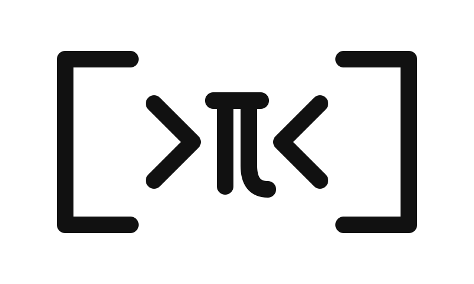
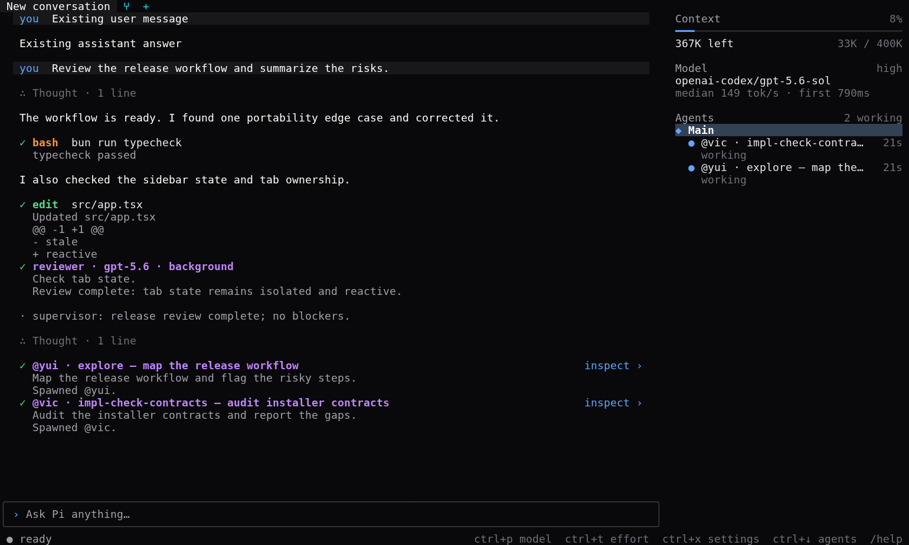
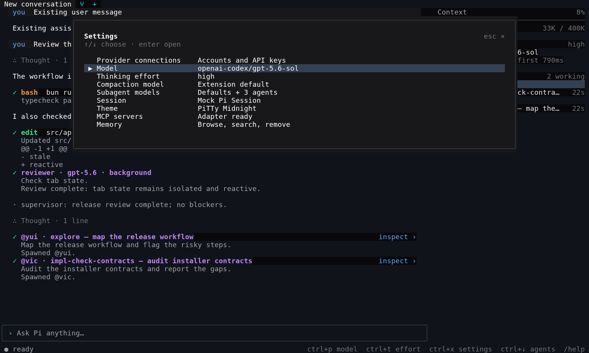
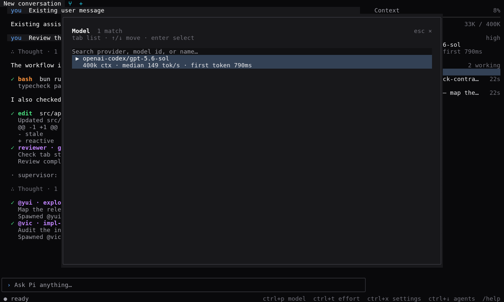
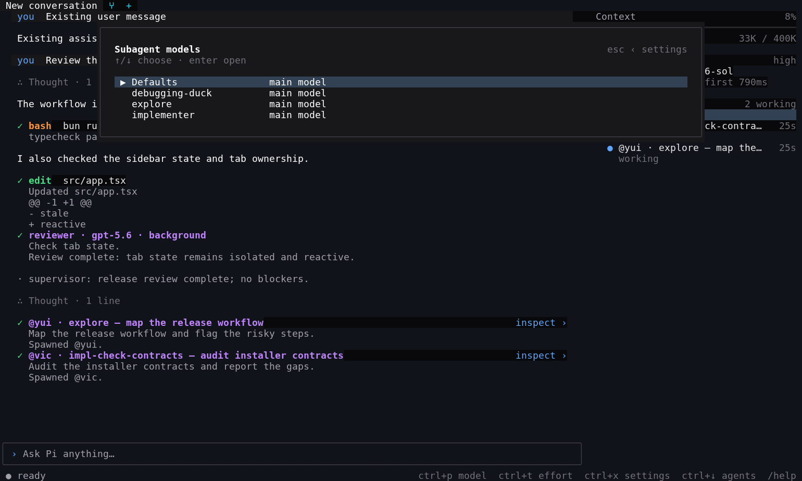
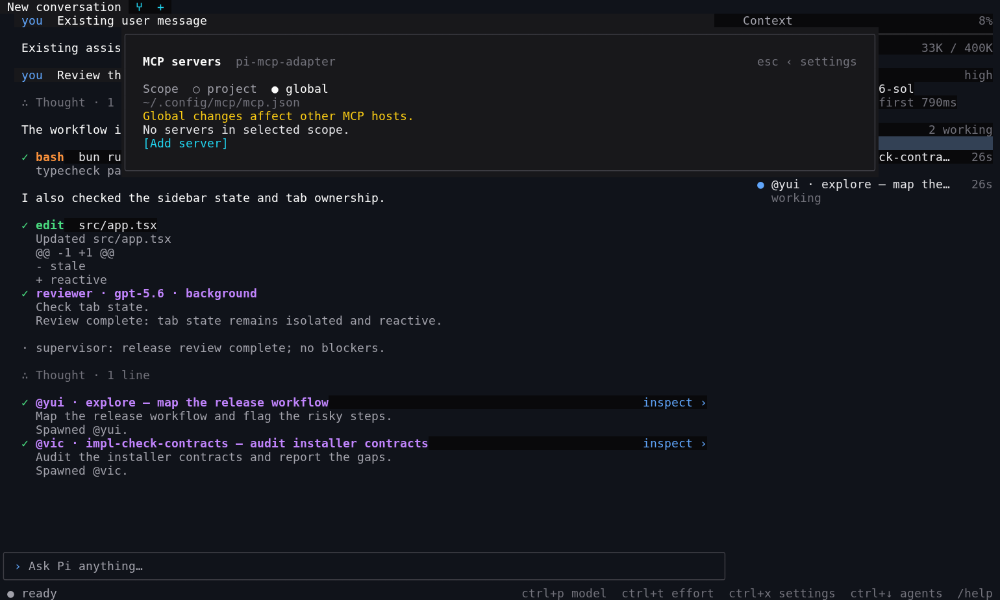
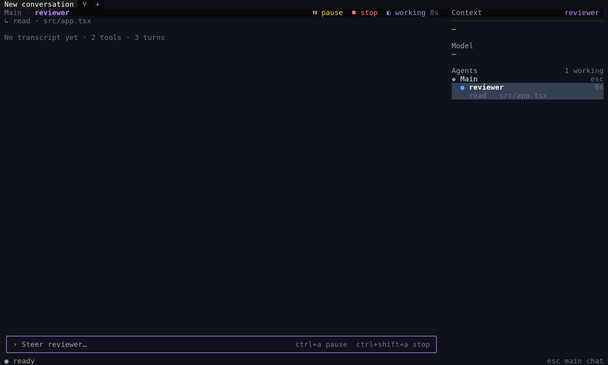
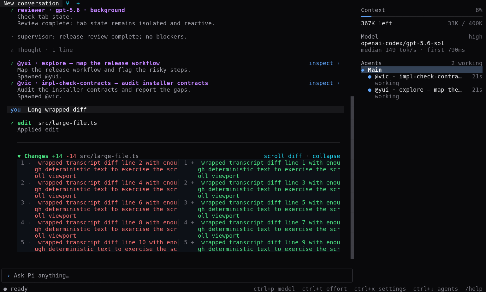

<p align="center">
  <picture>
    <source media="(prefers-color-scheme: dark)" srcset="docs/images/pitty-logo-dark.svg">
     π <]">
  </picture>
</p>

<h1 align="center">PiTTy</h1>

<p align="center">
  <strong>A terminal UI for the Pi coding agent.</strong>
</p>

<p align="center">
  <a href="https://github.com/mistrjirka/PiTTy/actions/workflows/ci.yml"></a>
  <a href="https://github.com/mistrjirka/PiTTy/releases"></a>
  <a href="LICENSE"></a>
</p>



<table>
  <tr>
    <td width="50%"><br><sub><b>Settings</b> (<code>Ctrl+X</code>): every setting on one screen</sub></td>
    <td width="50%"><br><sub><b>Model picker</b> (<code>Ctrl+P</code>): search, context size, measured speed</sub></td>
  </tr>
  <tr>
    <td><br><sub><b>Subagent models</b>: a default and a per-agent model and thinking level</sub></td>
    <td><br><sub><b>MCP servers</b>: project or global scope, preview before every write</sub></td>
  </tr>
  <tr>
    <td><br><sub><b>Subagent view</b>: same layout as the main chat, with steer, pause and stop</sub></td>
    <td><br><sub><b>Diff viewer</b> for edit and write tools</sub></td>
  </tr>
</table>

## What it is

PiTTy is a separate terminal frontend for the [Pi coding agent](https://github.com/earendil-works/pi). Pi keeps doing the agent work: authentication, providers, models, sessions, tools, skills, and extensions. PiTTy replaces Pi's built-in TUI and talks to Pi over RPC, so the two share the same configuration and session history and can be used side by side.

An empty session opens straight into the chat with a passive dashboard of recent sessions and commands; the prompt stays focused and writable.

## What's different from Pi's TUI

- **The prompt stays put.** The transcript scrolls on its own, so long conversations never push the input away.
- **Quiet transcript.** Each tool call is one row: status, tool, argument, duration. Timeouts over 10s show next to the duration. `Ctrl+O` expands details.
- **Subagents in the sidebar.** The right sidebar shows the agent tree under `◆ Main`. Open an agent to see its transcript in the main view, steer it, or pause, resume and stop it.
- **Context and speed at a glance.** The sidebar shows how much context is left and the model's live tokens per second, marked faster, usual or slower than its own median.
- **Pending messages stay editable.** Edit, cancel or combine queued messages, and keep sending during compaction.
- **Less hunting.** Searchable model picker (`Ctrl+P`), session browser (`/resume`), request map (`Ctrl+R`), and prompt history (`↑` on an empty prompt).
- **Live themes.** Ten presets plus full color-token editing, applied immediately.

Pi extensions generally keep working: commands, tools, prompt templates, skills, notifications, status updates, text widgets, and standard dialogs flow through RPC. [Text widgets](docs/EXTENSION_WIDGETS.md) appear above or below the editor, preserve ANSI styling, and scroll within a bounded area. With `pi-bg-bash` installed, the right sidebar lists background jobs. On the managed runtime, new input also moves running foreground commands to the background with the same process and original timeout deadline. Select a job to inspect its original command and paged output, or explicitly request analysis with Pi. Custom `pi-tui` component trees are not serialized, so extension-owned renderers won't look identical, and interactive `/login` is done once in regular Pi.

## Install

### Linux, macOS, and WSL

```bash
curl -fsSL https://raw.githubusercontent.com/mistrjirka/PiTTy/main/install.sh | sh
```

Then start it in the current project:

```bash
pitty
```

### Windows PowerShell

```powershell
irm https://raw.githubusercontent.com/mistrjirka/PiTTy/main/install.ps1 -OutFile $env:TEMP\pitty-install.ps1
& $env:TEMP\pitty-install.ps1 -WithPlugins
```

Requirements: Node.js 22.19 or newer, npm, and the Pi CLI. The installer downloads a versioned release, verifies its SHA-256 against the release `SHA256SUMS`, installs PiTTy's local Bun runtime, and creates the `pitty` and `pitty-resume` launchers.

The installer can also install the recommended Pi packages (subagent, one-round compaction, Todo, web access, semantic code search, persistent memory) with `--with-plugins` / `-WithPlugins`. Uninstalling PiTTy leaves Pi and those packages alone.

<details>
<summary><strong>Installer flags, upgrades, and running from source</strong></summary>

The POSIX installer accepts `--yes --with-plugins`, `--without-plugins`, and custom locations via `PITTY_INSTALL_DIR`, `PITTY_BIN_DIR`, `PITTY_VERSION`, and `PITTY_REPO`. On Windows, pass `-InstallDir` and `-BinDir` to the installer or `uninstall.ps1`.

```bash
pitty upgrade --check          # what's available
pitty upgrade                  # stage the newest stable release
pitty upgrade --version 0.6.7  # a specific version
```

Upgrades verify the release SHA-256, stage into a `.pending` directory, and activate on the next normal start with rollback on failure. Uninstall with `~/.local/share/pitty/uninstall.sh` on POSIX or `& "$env:LOCALAPPDATA\PiTTy\app\uninstall.ps1"` on Windows.

To run from source:

```bash
git clone https://github.com/mistrjirka/PiTTy.git
cd PiTTy
npm ci --ignore-scripts --no-audit --no-fund
node node_modules/bun/install.js
node bin/pitty.mjs
```

</details>

## Founder setup

Install the maintained plugins plus the selected skills and agents with `pitty founders-setup`.
Use `--dry-run` to preview changes or `--check` to inspect the installation. The first-install
scripts also accept `--founders-setup` / `-FoundersSetup`. Exported agents inherit the active
model. See [Founder setup and side questions](docs/FOUNDERS_SETUP.md) for package sources,
public installation, forks, editing, compatibility and `/btw` commands.

## Get started

```bash
pitty                              # start in the current directory
pitty -C /path/to/project          # pick a project directory
pitty -c                           # continue the newest Pi session
pitty --session /path/to/file.jsonl
pitty-resume -C /path/to/project   # open the session picker immediately
```

Inside PiTTy, the essentials are: `Enter` sends (or accepts a slash suggestion), `Shift+Enter` adds a newline, `Ctrl+P` picks a model, `Ctrl+X` opens Settings, `Ctrl+S` toggles the sidebar, `Ctrl+O` expands or collapses tool and thinking details, `Ctrl+I` opens the selected subagent, `Ctrl+Shift+A` stops a controllable subagent, and `Esc` closes a dialog or aborts the current turn. Legacy `pi-subagents` runs also support pause/resume controls. `/help` lists everything; the full [usage and controls guide](docs/USAGE.md) has the details.

## Managed Pi runtime (automatic)

`pitty upgrade` also stages a patched private copy of Pi. It adds editable pending messages, session memory and Python tool checkpoints. It never changes your global Pi, settings, credentials or sessions. If your installed Pi is not the verified version (currently **Pi 1.5.2** with **pi-code-tool 0.6.2**), PiTTy uses the unchanged global Pi and says why. Opt out with `PITTY_USE_UPSTREAM_PI=1 pitty`. Details: [Managed Pi runtime](docs/managed-runtime.md).

## Optional integrations

PiTTy works without extra packages. These add specialized panels when installed:

| Package | Adds |
| --- | --- |
| `git:github.com/mistrjirka/pi-subagent` | Profile-driven child-agent tree, live inspection, waiting-state visibility, steer/stop |
| `git:github.com/mistrjirka/pi-one-round-compaction` | One-round parallel compaction with streamed lane progress |
| `npm:@juicesharp/rpiv-todo` | Todo tool for Pi |
| `npm:pi-web-access` | Web search and page-fetch tools for Pi |
| `npm:pi-diet-semble` | Semantic code search for Pi |
| `npm:pi-bg-bash` | Background jobs: status, original command, 64-KiB output pages, and optional analysis |
| `npm:pi-hermes-memory` | Persistent memory behind PiTTy's Memory browser |
| `npm:pi-mcp-adapter` | MCP config management and connection status; not needed with Pi's built-in MCP |
| `npm:pi-subagents` | Legacy workflow child-agent support, including pause/resume and queued steering |
| `npm:pi-smart-compact` | Smart Compact progress on the compaction surface (alternative compaction engine) |

```bash
pi install git:github.com/mistrjirka/pi-subagent git:github.com/mistrjirka/pi-one-round-compaction npm:@juicesharp/rpiv-todo npm:pi-web-access npm:pi-diet-semble npm:pi-hermes-memory

# MCP configuration works with Pi's built-in MCP (0.99+). On older Pi, install the adapter:
# pi install npm:pi-mcp-adapter
# Legacy pi-subagents remains supported; do not install both runtimes unless you intentionally want both.
# pi install npm:pi-subagents
# pi-smart-compact is a competing compaction engine; install it instead of pi-one-round-compaction only if you prefer it.
# pi install npm:pi-smart-compact
```

## Platform support

| Platform | Status |
| --- | --- |
| Linux | Primary development platform |
| macOS | Included in CI and supported by the POSIX installer |
| Windows | Included in CI and supported by `install.ps1`; benefits from wider real-world testing |
| WSL | Supported through the POSIX installer and Linux runtime |

## Documentation

- [Usage and controls](docs/USAGE.md)
- [Themes](docs/THEMES.md)
- [Architecture and compatibility](docs/OPEN_SOURCE_READINESS.md)
- [Documentation index](docs/README.md)
- [Changelog](CHANGELOG.md)

Contributions follow [CONTRIBUTING.md](CONTRIBUTING.md); security reports go through [SECURITY.md](SECURITY.md). Diagnostics live under `~/.local/state/pitty/` and omit prompt text, tool output, and source contents by default.

## License

MIT. See [LICENSE](LICENSE).

PiTTy is not affiliated with the Pi or OpenCode maintainers.