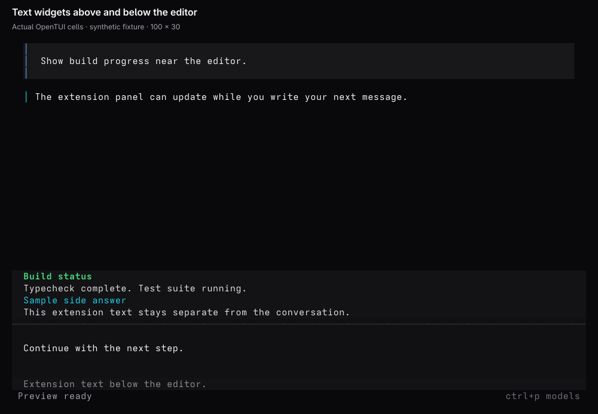

# Extension text widgets

PiTTy displays string widgets from any Pi extension above or below the message editor. Widgets update in place and do not become conversation messages.



This image captures the actual OpenTUI component cells with synthetic data. It is not a desktop screenshot. The terminal font can change the pixel appearance.

## Behavior

- The same widget key replaces its previous content. Different keys remain separate and keep a stable display order.
- The default position is above the editor. Extensions can choose below the editor.
- Long text wraps and scrolls inside a bounded area. Use the mouse wheel over that area. The editor keeps its draft and keyboard focus.
- ANSI colors and text styles are preserved. Markdown punctuation remains literal, as in Pi's string-widget API.
- Widgets belong to their conversation tab. Inactive tabs receive updates. Dialogs do not block widget updates.
- PiTTy's session picker, `/new` and fork operations clear old widgets while retaining replacement-session startup updates. Stopping Pi clears its widgets.
- Widgets are temporary UI state. Existing conversation files require no migration. Extensions can republish their current state on startup.

Generic widget events contain no session identity. An extension that starts asynchronous work must cancel or ignore its old work after a session switch. PiTTy cannot identify a late event that the extension sends without an owner. If an extension changes the session internally, outside PiTTy's tracked operations, the next session-state check clears existing widgets, including any new startup widgets already received. That extension must republish them. Session-tagged events would remove this protocol limitation.

## Extension API

The existing Pi API works in both its TUI and RPC modes:

```ts
ctx.ui.setWidget("build-progress", [
  "Build status",
  "Typecheck complete. Tests running.",
]);

ctx.ui.setWidget("branch-status", [
  "Branch: example",
], { placement: "belowEditor" });

ctx.ui.setWidget("build-progress", undefined); // Remove this widget.
```

For streaming text, send the accumulated lines under the same key. Widget updates need no response. A command that starts a long task should return immediately and publish later updates from its tracked task.

Component factories, custom TUI overlays and terminal-input callbacks still require Pi's native TUI. Generic string support does not serialize those components.

[Pi RPC contract](https://github.com/mistrjirka/pi/blob/28fde6970655d29178c393918cbcf8a688891dd7/packages/coding-agent/docs/rpc-extension-ui.md)

## Previews

- [Normal terminal](screenshots/extension-widgets.png)
- [Narrow terminal](screenshots/extension-widgets-narrow.png)
- [Long output](screenshots/extension-widgets-overflow.png)
- [Long output after scrolling](screenshots/extension-widgets-overflow-scrolled.png)

Generate the captures from the repository root with Bun and `rsvg-convert` installed:

```bash
./node_modules/.bin/bun --conditions=browser scripts/extension-widget-preview.tsx
```

The preview starts no Pi process and sends no model requests.

## Side-question integration

[Founder setup](FOUNDERS_SETUP.md) installs the owned `mistrjirka/PiTTy-BTW` extension. Its `/btw` command uses this generic string-widget path for loading, answers, cancellation and errors. Other extensions use the same widget API.

| Approach | Fits | Remaining work |
| --- | --- | --- |
| Adapt MIT `dbachelder/pi-btw` presentation | Persistent side conversations with tools, model selection and saved history | Publish string widgets, acknowledge commands immediately, replace delayed transcript output |
| Owned `mistrjirka/PiTTy-BTW` | Temporary, tool-free questions using safe main-context snapshots | Snapshot and provider support are in the managed fork. Live cache measurement remains pending. |

The inspected [`pi-btw` v0.8.1](https://github.com/dbachelder/pi-btw/tree/374465f0a2bd3df502c4f981405e61567d92046b) contains 3,451 production TypeScript lines and ten commands. Its child-session path changes the system prompt and tool declarations, creates another session identity, and retains the original parent snapshot for later questions. Adapting its display is useful for its existing feature set. The requested one-shot behavior would replace its generation and state design, so a small owned extension is the cleaner choice.

[Fatih's extension](https://github.com/Fatih0234/btw/tree/931930656e8d101b20d3155550f77832237d35ee) uses a component factory that RPC ignores. Its busy snapshot and provider routing also need changes. No license declaration was found in that inspected revision.

The owned extension uses these boundaries:

1. Keep the main model, effective prompt, tool schemas and cache identity, then append the side question.
2. Use one request with no host tool execution and a separate cancellation signal. Do not replace the main provider continuation.
3. Publish loading, answer and error through string widgets. Do not write the side exchange to the main session history.
4. Capture fresh completed context for each question and discard late results after a session change.
5. Use a dedicated native side-question adapter for DoppelClaude. Its normal provider stream is not an isolated side-question operation.
6. Require live measurements of cache reads, latency and the following main request before claiming savings.

DoppelClaude's locked SDK 0.3.310 implements `askSideQuestion` at runtime but omits it from the public Query declaration. The fork checks that capability and validates its reply, using only an existing live query for the same session and model. OpenAI Codex side questions use an independent HTTP stream so they cannot replace the main WebSocket continuation. Matching a request prefix makes cache reuse possible, not guaranteed. No live cache or latency result was measured for this change.
